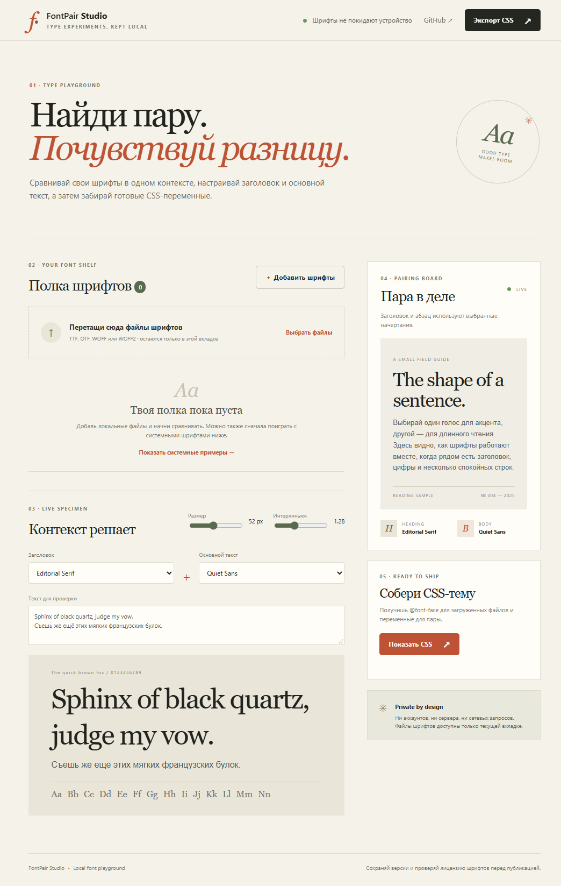

# FontPair Studio

**Compare local fonts in the same context. Export a reusable CSS type theme.**

FontPair Studio is a small, local-first typography playground. Load up to six TTF, OTF, WOFF, or WOFF2 files, compare a heading and body font, adjust the specimen, and export CSS variables and `@font-face` declarations.



## Run it

Requires Node.js 20 or newer. From this folder:

```sh
npm start
```

Open `http://127.0.0.1:4173`. The local server is bound to loopback only. The app also ships as a static site and is deployed with GitHub Pages.

## Use it

1. Drop font files onto the shelf or choose them from your device.
2. Select a heading font and a body font. Built-in system examples work without uploading files.
3. Adjust the sample text, size, and line height.
4. Export or copy the CSS theme. Put exported font files beside the CSS file so its relative `@font-face` paths resolve.

Files are read in the current browser tab and are never sent to a server. The font preview uses temporary browser object URLs; removing a font or leaving the page releases those URLs. The CSS export contains local file names, not font data. Check each font's license before redistributing it.

## Development

```sh
npm test
npm run check
```

The pure `font-core.js` module creates escaped CSS, normalizes names, detects supported formats, and clamps theme settings. The test suite uses Node's built-in test runner.

## License

MIT. Font files loaded by users are not included and remain under their owners' licenses.
